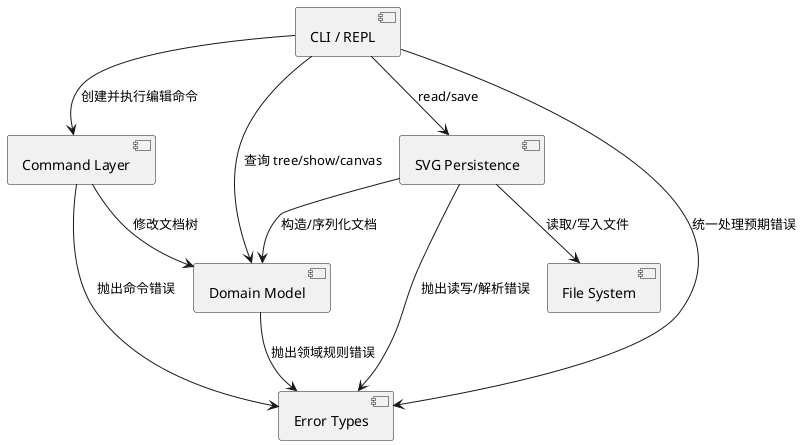

# SVG 编辑器项目文档

本文档描述当前 Phase 1 CLI 版本的实际设计与实现。项目使用 TypeScript 编写，以 Command 模式实现可撤销编辑，以 Composite 模式表示 SVG 图形树，并通过独立的 Persistence 模块完成 SVG 文件读写。

## 架构方案

### 模块划分

| 模块 | 目录 | 职责 |
|---|---|---|
| CLI | `src/cli/`、`src/main.ts` | REPL 生命周期、带引号参数解析、命令名分发、统一错误输出 |
| Command | `src/commands/` | 把每次编辑及其逆操作封装成命令；保存最小撤销状态；管理 undo/redo 历史 |
| Model | `src/model/` | SVG 文档树、唯一 ID、父子关系、z-order，以及图形的移动、缩放、属性更新和序列化行为 |
| Persistence | `src/persistence/` | XML 解析、SVG 读取、缺失 ID 补全及文件写入 |
| Error | `src/errors/` | 统一可展示的领域错误类型 |
| Tests | `tests/` | 命令行为、历史、组合结构、错误原子性和 SVG round-trip 回归测试 |

当前工程的主要目录如下：

```text
svg-editor/
├── src/
│   ├── cli/             # 命令解析与应用入口
│   ├── commands/        # Command 接口、具体命令与历史栈
│   ├── errors/          # 领域错误
│   ├── model/           # SVG 文档树、图形及工厂
│   ├── persistence/     # SVG 读取、解析与保存
│   └── main.ts          # readline REPL 启动入口
├── tests/               # 自动化测试
├── doc/README.md        # 本文档
└── dist/                # TypeScript 编译产物，不提交到 Git
```

PlantUML 组件图：



### 设计模式的选择

#### Command

`Command` 定义 `execute/undo/redo`，每个编辑操作各有一个具体类，例如 `MoveCommand`、`GroupCommand` 和 `DeleteCommand`。`CommandHistory` 只依赖统一接口，不了解具体编辑细节。

每个具体命令负责实现自己的逆操作，并只保存撤销自身所需的最小状态。例如，`MoveCommand` 保存位移量并用反向位移撤销；`SetCommand` 保存旧属性值；`DeleteCommand` 保存被删除的子树、原父容器和原索引；`GroupCommand` 保存所有目标原来的父容器与顺序。`CommandHistory` 只管理 undo/redo 两个栈，不了解具体恢复细节。新编辑会清空 redo 栈；IO 命令通过 history barrier 禁止随后的 undo/redo。

当前各编辑命令的撤销信息如下：

| 命令 | 为 undo 保存的信息 | undo 的实际操作 |
|---|---|---|
| `create` | 新图形对象及其插入位置 | 从原位置移除该对象 |
| `delete` | 被删除的子树、父容器 ID、同级索引 | 将同一子树插回原位置 |
| `move` | `dx`、`dy` | 执行 `move(-dx, -dy)` |
| `scale` | 缩放因子 | 按倒数因子缩放 |
| `set` | 属性原值（包括原本不存在） | 恢复旧值或删除新增样式 |
| `group` | 各目标原来的父容器和同级索引 | 解散新组并逐一放回原位置 |
| `ungroup` | 原组、组的位置和原子节点 | 移除提升后的节点并重建原组 |
| `addto` | 对象移动前后的层级位置 | 移回原父容器和索引 |
| `front` / `back` | 调整前后的同级位置 | 恢复原来的 z-order |

不使用整个 `SvgDocument` 的快照或图形树深拷贝。`redo` 也不是恢复文档快照，而是由同一个具体命令重新执行正向操作。

结构命令在修改前完成全部校验，随后执行不会失败的确定性树操作，从而保证失败命令不改变状态。`group`、`ungroup` 等涉及多个节点的命令把整组变化封装为一个 Command，因此仍然是一条命令对应一个 undo 单元。

#### Composite

`Shape` 是叶子和容器的共同抽象。`RectShape`、`CircleShape` 等叶子实现自身的几何行为；`GroupShape` 保存子节点，并把 `move`、`scale` 递归传播给子树。命令只面向 `Shape`，因此不需要为容器另写一套移动、缩放或删除流程。

#### Factory

`ShapeFactory` 是唯一的图形类型名分发位置，负责构造六种内置图形。CLI 创建和 SVG 读回都复用该工厂。后续插件化阶段可将内部注册表替换为 `ShapeProvider` 注册机制。

### 依赖方向规则

1. `model` 不依赖 CLI、Command 或 Persistence；领域行为不能知道输入来自终端还是文件。
2. `commands` 可以依赖 `model`，但 `model` 不能反向依赖具体命令。
3. `persistence` 可以依赖 `model` 来重建和序列化文档；模型不直接访问文件系统。
4. `cli` 是应用边界，可以依赖 Command、Model 和 Persistence，并负责组装它们。
5. `tests` 可以依赖所有生产模块，生产代码不能依赖测试。

当前允许按名字分派的两处是：

- `CliApplication.handlers`：命令名到处理器；
- `ShapeFactory`：图形类型名到构造器。

这两处集中分派满足本阶段要求，但也是后续插件化的待重构项：命令和图形提供者应能通过注册接口扩展，而不是修改内核注册表。

### 变化点假设

1. **新增图形类型最可能发生。** 当前变化被集中到 `ShapeFactory` 和新的 `Shape` 子类；本阶段没有实现 `box`，因为要求明确把它留给插件阶段。
2. **新增命令较常见。** 每条编辑命令是独立类，历史管理无需修改；当前仍需向 CLI 注册表添加处理器，后续可以改为 CommandProvider。
3. **输入通道可能扩展为 GUI 或 Agent。** 领域模型和命令不依赖 readline，因此其他通道可以复用它们。
4. **SVG 方言可能扩大。** 当前读取器识别本阶段的 `rect`、`circle`、`ellipse`、`line`、`text`、`g` 六种元素，并只把模型支持的几何与样式属性读入；没有为任意 SVG/CSS/滤镜建立通用 DOM，因为这超出阶段范围。读取器已与模型隔离，可单独替换。
5. **复杂编辑可能增加。** 当前具体命令保存最小逆操作信息；未来若加入一次修改多个独立对象的操作，可以引入由多个子命令组成的复合 Command，而无需改变 `CommandHistory`。

## 过程记录

### 1. 从空工程确定边界

初始仓库只有 npm/TypeScript 配置，没有源码、测试和文档。与 AI 讨论后先确定 `CLI → Command → Model` 以及 `Persistence → Model` 的依赖方向，再开始实现，以避免把解析、业务规则和文件 IO 堆进一个类。

### 2. 撤销方案的修订

初版为了快速保证复合操作原子性，曾使用执行前后的全文档快照。复核 Command 模式的教学目标后，确认这会把撤销责任放到 Memento，而不是具体 Command，因此进行了重构：删除 `DocumentSnapshot`、`SvgDocument.snapshot/restore` 和所有图形深克隆；每个命令改为保存最小逆操作信息。重构后新增了 create/delete/set/move/scale/group/ungroup/addto/front/back 的双向回归测试，特别检查跨父容器分组和同级索引恢复。

### 3. Windows 路径回归

首轮测试发现 tokenizer 把带引号 Windows 路径中的反斜杠当成转义符，导致 `C:\...` 变成无法访问的路径。通过真实 `read/save` 测试确认问题后，将反斜杠改为普通字符并保留双引号的分词作用。

### 4. 工厂惰性求值修订

SVG 读回最初用一个 Map 同时计算所有图形的参数，读取 `<rect>` 时也错误访问了 `cx`。测试暴露该问题后，把 Map 的值改成惰性参数读取函数，仅计算被选中类型的属性。类型分派仍集中在工厂内。

### 5. 测试运行器调整

当前 Windows 环境下 `tsx` 在获取系统临时目录时出现 `uv_os_get_passwd ENOMEM`，但 TypeScript 编译和 Node 执行正常。为排除环境偶然性，将 CLI 和测试流程都改为先 `tsc`，再由 Node 执行编译后的入口或原生测试运行器。

### 6. 自动 ID 冲突修订

边界审查发现：若无 ID 的 `<rect>` 出现在文件前部，而显式 `rect1` 在后部，逐行分配会抢占 `rect1`。读取器现先递归收集所有显式 ID，再为匿名元素选择未被保留的编号，并加入回归测试。

## 一致性自查

### 模块划分

实际目录与方案一致。错误类型被单独放入 `src/errors/`，这是实现过程中明确增加的小模块，目的是让 CLI 只给预期错误统一添加 `error:` 前缀。该修订已在本文件的模块表中体现。

### 依赖方向

抽样检查结果：

- `src/model/` 没有导入 `cli`、`commands` 或 `persistence`；
- `src/commands/` 只依赖模型和错误类型；
- 文件系统 API 只出现在 `src/persistence/`；
- readline 只出现在 `src/main.ts`。

目前没有发现违反既定依赖方向的导入。

### 设计与实现的一致性

- Command 模式已经落实为统一的 `Command.execute/undo/redo` 接口以及独立的具体命令类。
- Composite 模式已经落实为 `Shape` 抽象、叶子图形和持有子节点的 `GroupShape`；组与普通图形都可被 `move`、`scale`、`delete` 等命令统一操作。
- Factory 已落实为 `ShapeFactory`，CLI 创建图形和 SVG 读取都通过同一构造入口。
- 撤销实现已从早期全文档快照修订为具体 Command 保存最小逆操作状态，与当前架构方案一致。

## 质量保证手段

1. `npm run typecheck` 使用 TypeScript strict 模式、未检查索引检查、override 检查和完整返回检查。
2. `npm run build` 验证全部生产代码和测试可编译。
3. `npm test` 当前共有 **21 项自动化测试**，覆盖：六种内置图形、`in`、Composite 移动、group/ungroup、循环防护、front/back、set 白名单、失败原子性、传统逆操作 undo/redo、父容器与索引恢复、redo 清空、IO barrier、缺失 ID、重复 ID、保留显式 ID、XML 转义以及 save/read round-trip。
4. 文件读写测试使用真实临时 SVG 文件，而不是仅模拟字符串。
5. `tree`、`show` 和保存结果由测试检查关键结构与属性，使结构正确性和序列化正确性相互验证。

此外当前阶段也并未实现 `box` 插件类型、任意 SVG 元素、CSS 和复杂 transform
本次文档更新前执行了以下验证，结果均通过：

```text
npm run typecheck
npm test    # 21 passed, 0 failed
```
